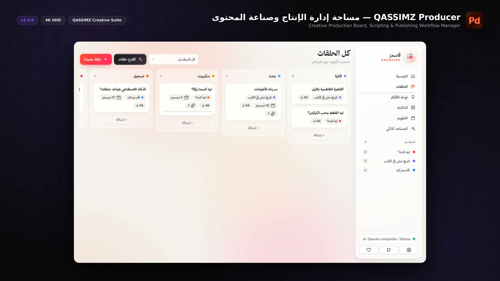

# QASSIMZ Producer
### مساحة إدارة الإنتاج وصناعة المحتوى

<!-- اللغات المدعومة أسفل اللوجو مباشرة -->

   

  
  
  

<em>Creative Production Board, Scripting & Publishing Workflow Manager</em>

 

---

## 1. نظرة عامة

أداة متكاملة لصنّاع المحتوى وفرق الإنتاج لتخطيط الحلقات، كتابة السكربتات، تتبع مراحل المونتاج والنشر عبر لوحة كانبان واضحة وسريعة.

---

## 2. المميزات الرئيسية

1. **لوحة إنتاج تفاعلية (Production Board):** تتبع كل فيديو من الفكرة والسكربت حتى المونتاج والنشر.
2. **إدارة المهام والمواعيد:** ترتيب أولويات التصوير والمونتاج والمراجعة بسهولة.
3. **محرر سكربتات وملاحظات مدمج:** كتابة نصوص الحلقات وقوائم اللقطات داخل نفس البطاقة.
4. **تخزين محلي سريع وموثوق:** يعمل بالكامل بدون إنترنت مع حفظ تلقائي فوري.
5. **واجهة مريحة للعين:** تصميم داكن احترافي مخصص لساعات العمل الطويلة.

---

## 3. التحميل والتثبيت

1. **الطريقة الموصى بها (عبر QASSIMZ Hub):**
   - حمّل وافتح [**QASSIMZ Hub**](https://github.com/ahmedqassimtv-commits/qassimz-hub/releases/latest) لتثبيت **QASSIMZ Producer** وتلقي جميع التحديثات التفاضلية (`.qpkg`) تلقائياً بضغطة زر.
2. **التحميل المباشر من GitHub Releases:**
   - افتح صفحة [**أحدث إصدار (v1.3.0)**](https://github.com/ahmedqassimtv-commits/qassimz-producer/releases/latest).
   - حمّل ملف المثبّت (`Setup.exe`) للتثبيت العادي بدون صلاحيات مسؤول، أو النسخة المحمولة (`Portable.zip`) إن وجدت.

---

## 4. متطلبات التشغيل

1. نظام التشغيل: Windows 10 / 11 (64-bit).

---

## 5. منظومة قَاسِمز الإبداعية (QASSIMZ Creative Suite)

| # | التطبيق | الوصف | المستودع |
|---:|---|---|---|
| 1 | **QASSIMZ Hub** | مركز ومنظومة قَاسِمز الإبداعية | [GitHub](https://github.com/ahmedqassimtv-commits/qassimz-hub) |
| 2 | **QASSIMZ Thumbs** | محرك مصغّرات ويندوز والعارض الفوري | [GitHub](https://github.com/ahmedqassimtv-commits/qassimz-thumbs) |
| 3 | **QASSIMZ FONTs** | مدير الخطوط الاحترافي والمزامنة السحابية | [GitHub](https://github.com/ahmedqassimtv-commits/qassimz-fonts) |
| 4 | **QASSIMZ Studio** | استوديو المونتاج والتحرير الاحترافي | [GitHub](https://github.com/ahmedqassimtv-commits/qassimz-studio) |
| 5 | **QASSIMZ Producer** **(الحالي)** | مساحة إدارة الإنتاج وصناعة المحتوى | [GitHub](https://github.com/ahmedqassimtv-commits/qassimz-producer) |
| 6 | **QASSIMZ Music** | مشغّل الموسيقى ومكتبة الصوتيات للمونتاج | [GitHub](https://github.com/ahmedqassimtv-commits/qassimz-music) |
| 7 | **QDM — QASSIMZ Download Manager** | مدير التحميل السريع متعدد المسارات | [GitHub](https://github.com/ahmedqassimtv-commits/qdm) |
| 8 | **QASSIMZ Organizer** | منظّم مجلدات المشاريع والملفات الإبداعية | [GitHub](https://github.com/ahmedqassimtv-commits/qassimz-organizer) |
| 9 | **QASSIMZ Study** | منصة المذاكرة والتركيز وإدارة الدروس | [GitHub](https://github.com/ahmedqassimtv-commits/qassimz-study) |
| 10 | **QASSIMZ VOX FX** | إضافة المؤثرات البصرية والصوتية لـ Premiere Pro | [GitHub](https://github.com/ahmedqassimtv-commits/qassimz-vox-fx) |
| 11 | **QASSIMZ Captions** | إضافة الترجمة والكتابة التلقائية لـ Premiere Pro | [GitHub](https://github.com/ahmedqassimtv-commits/qassimz-captions) |
| 12 | **QASSIMZ Footage** | إضافة البحث واستيراد اللقطات لـ Premiere Pro | [GitHub](https://github.com/ahmedqassimtv-commits/qassimz-footage) |
| 13 | **QASSIMZ MOGRT Hub** | مكتبة ومدير قوالب MOGRT لـ Premiere Pro | [GitHub](https://github.com/ahmedqassimtv-commits/qassimz-mogrt-hub) |
| 14 | **QASSIMZ MOGRT Maker** | صانع قوالب MOGRT الاحترافي لـ Premiere Pro | [GitHub](https://github.com/ahmedqassimtv-commits/qassimz-mogrt-maker) |
| 15 | **QASSIMZ Export** | إضافة التصدير الذكي السريع لـ Premiere Pro | [GitHub](https://github.com/ahmedqassimtv-commits/qassimz-export) |

---

  © 2026 <strong>QASSIMZ Creative Suite</strong> — Ahmed Qassim. جميع الحقوق محفوظة.

