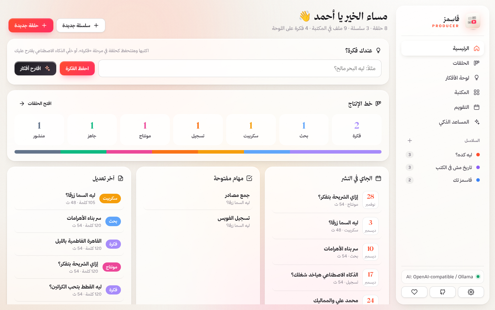
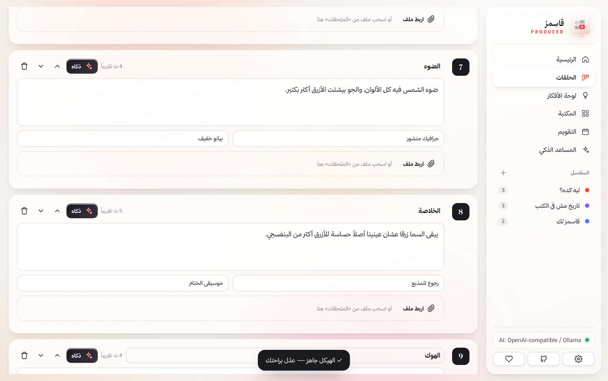
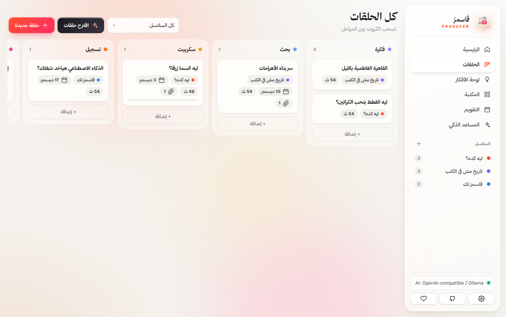
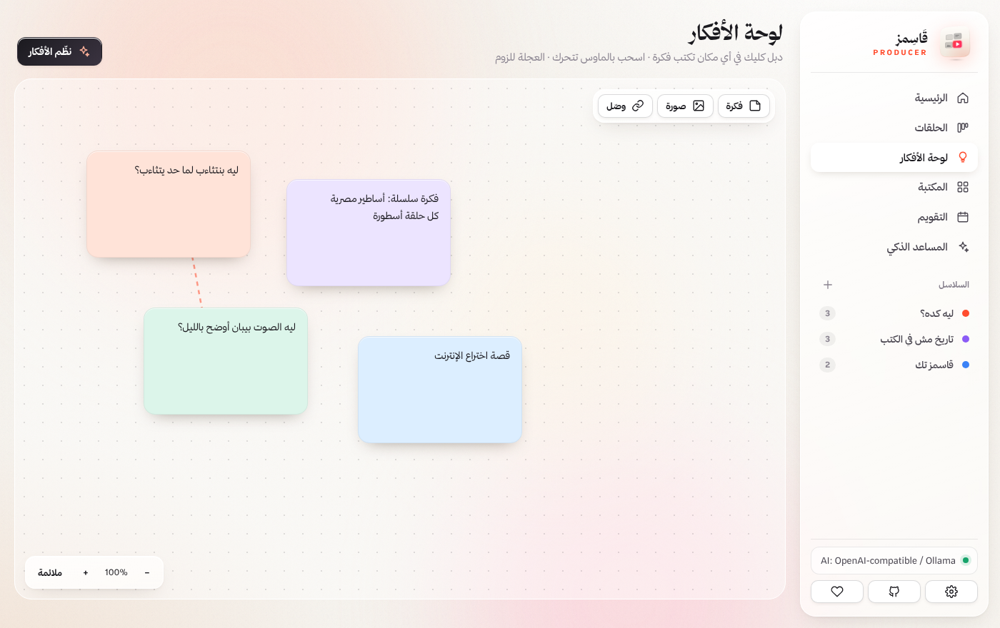
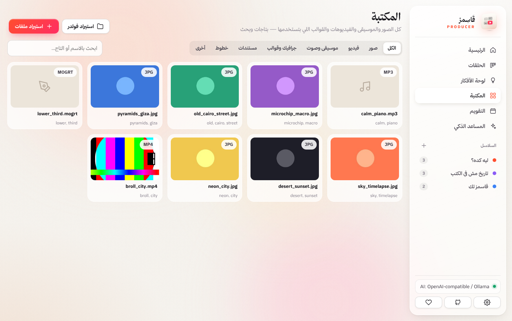
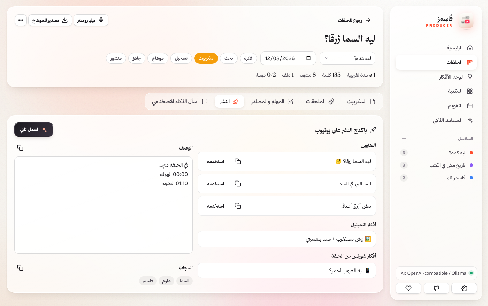
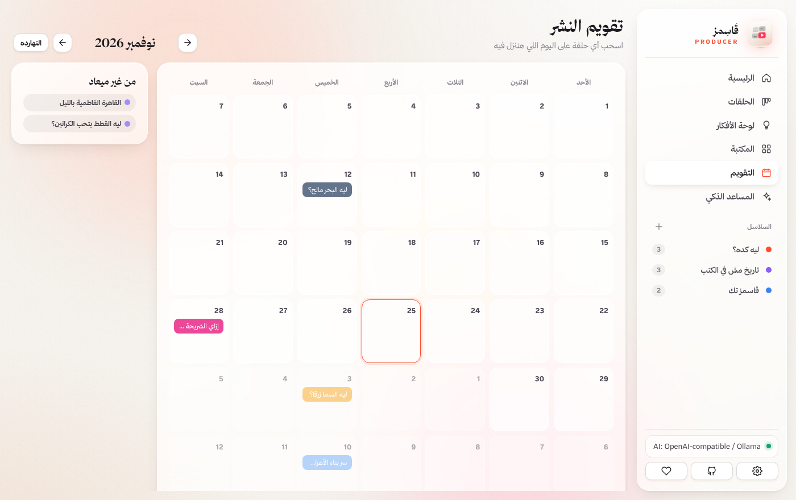
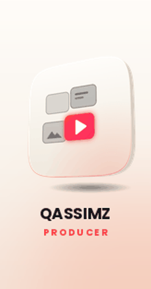

<div align="center">


# QASSIMZ Producer

**برنامج واحد لإنتاج الفيديوهات والسلاسل: من الفكرة للسكريبت للملحقات للنشر، ومعاه مساعد ذكاء اصطناعي.**

من **أحمد قاسم — قَاسِمز** · مجاني ومفتوح المصدر · Windows 10/11

[⬇️ تحميل آخر إصدار](https://github.com/ahmedqassimtv-commits/qassimz-producer/releases/latest) ·
[🐞 الدعم والإبلاغ عن مشكلة](https://github.com/ahmedqassimtv-commits/qassimz-producer/issues) ·
[🌐 qassimz.com](https://qassimz.com)



</div>

---

## ✨ كل حاجة في مكان واحد

| | |
|---|---|
| 🏠 **الرئيسية** | خط الإنتاج كله، والجاي في النشر، والمهام المفتوحة، وتسجيل أي فكرة في ثانية |
| 🎬 **الحلقات والسلاسل** | لوحة Kanban: فكرة ← بحث ← سكريبت ← تسجيل ← مونتاج ← جاهز ← منشور (بالسحب والإفلات) |
| 📝 **السكريبت** | هوك + مشاهد، ولكل مشهد: النص والمرئي والصوت والملفات المربوطة، والمدة بتتحسب لوحدها |
| 🎤 **تيليبرومبتر** | شاشة كاملة للتسجيل، فيها تحكم في السرعة والخط ووضع المراية |
| 📎 **الملحقات** | صور وفيديو وموسيقى وMOGRT وPSD لكل حلقة، وتسحبها على المشهد |
| 💡 **لوحة الأفكار** | Whiteboard مفتوحة: أفكار ملونة وصور وتوصيلات، والفكرة تتحول لحلقة بضغطة |
| 📚 **المكتبة** | كل ملفاتك بمصغّرات وتاجات وبحث، وتعرف كل ملف اتستخدم فين |
| 📅 **التقويم** | تقويم النشر، وتسحب الحلقة على اليوم اللي هتنزل فيه |
| 📦 **تصدير للمونتاج** | فولدر جاهز فيه السكريبت (Word + Markdown) والملفات متقسمة و`edit-list.csv` |

## 🤖 الذكاء الاصطناعي
- **أفكار حلقات** بالهوك والزاوية ونقط البحث.
- **هيكل سكريبت كامل** بالعامية المصرية بأسلوب الحكي.
- **إعادة صياغة:** أقصر، أطول، عامية، كوميدي، أبسط، تصحيح، و5 هوكات.
- **لكل مشهد:** اقتراح المرئي والموسيقى وكلمات بحث للـ stock، وربط ملفات من مكتبتك.
- **مهام الإنتاج** من السكريبت.
- **باكدج النشر:** عناوين، ووصف بفهرس زمني، وتاجات، وأفكار ثمبنيل وشورتس.
- **تلخيص المصادر**، و**تاجات للصور** (بيشوف الصورة)، و**تنظيم الأفكار المبعترة** في مجموعات.
- **شات** عارف الحلقة أو كل القناة.

**الخدمات:** GitHub Models (**مجاني** بتوكن من حسابك) · Claude (Anthropic) · Ollama / LM Studio (محلي).

<table><tr><td></td><td></td></tr>
<tr><td></td><td></td></tr>
<tr><td></td><td></td></tr></table>

## 🚀 التسطيب
1. نزّل `QASSIMZ-Producer-Setup-x.x.x.exe` من [Releases](https://github.com/ahmedqassimtv-commits/qassimz-producer/releases/latest).
2. لو ظهرت شاشة SmartScreen: **More info ← Run anyway**.
3. افتح ⚙ **الإعدادات ← الذكاء الاصطناعي**، واختار GitHub Models والصق التوكن.
   (اعمله من [هنا](https://github.com/settings/personal-access-tokens/new) واختار صلاحية **Models: Read-only**.)



شاشة التسطيب نفسها فيها اللوجو بيلف 3D.

البيانات كلها على جهازك في `%APPDATA%\QASSIMZ Producer`، والملفات في فولدر المكتبة اللي تختاره.
<br clear="left">

## 🛠️ للمطورين
```bash
pip install -r requirements.txt
python app/main.py              # البرنامج
python app/dev.py /tmp/data     # نفس البرنامج في المتصفح للتطوير
```
- `app/store.py`: قاعدة البيانات (SQLite) وكل العمليات.
- `app/ai.py`: الذكاء الاصطناعي.
- `app/server.py`: الـ API المحلي.
- `app/ui/`: الواجهة.
- `assets/logo-layers/`: اللوجو الـ 3D (طبقات SVG + سكريبت يرندر الفريمات).

**نشر إصدار جديد:** غيّر `VERSION` في `app/server.py` واعمل push على `main`.

---
<div align="center">© 2026 أحمد قاسم — قَاسِمز · MIT License</div>
